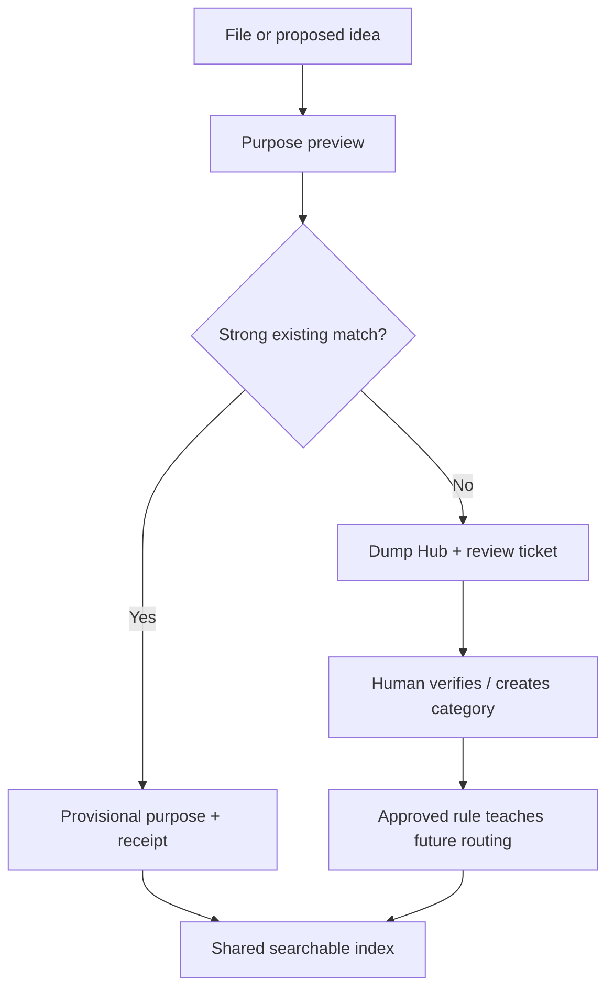

# HERMES Purpose Funnel v0.4 — first working adaptive vertical slice

## Core decision

Keep the proven Python file transfer, checksum, SQLite ledger, HERMES bot and optional Drive mirror. Add a **versioned, language-neutral JSON API** so Java, Syntra, IXO and APC/Odin can submit metadata and observe an explanation of where it *might* belong. Java is an adapter, **not a demand that everyone rewrites working software**.

### Purpose means more than file extension

The router currently uses explicit filename/project/description keywords (not the content of a document) to rank known purposes. Its scores are rule weights, **not statistical confidence probabilities**. Category naming is separate from actual Discord channel creation and from access control.



**Examples:**

| Intake | Current outcome | Side effect |
|---|---|---|
| `SyntraBridge.java` | `development` suggested | Label only, no code executed |
| `VELA_music.mid` | `creative` suggested | Label only, no playback |
| `unknown_payload.bin` | `dump_inbox`, needs review | One human triage ticket |
| `scene.mesh` | Needs review until approved simulation keywords | Admin can create a taxonomy entry; **no Discord category made** |
| `private_budget.md` | Restricted | Shared-hub upload refused based on filename metadata; **not a substitute for document scanning/ACL** |

## What is truly adaptive today

1. Every new upload receives a purpose score and immutable routing event, tied to the original SHA-256 artifact ID.
2. Unknown inputs create a review ticket; the original file stays in shared content-addressed storage **only if the member deliberately uploaded it**.
3. A member can request a new purpose or missing file; the hub holds an unexecuted ticket.
4. Only a hub admin can approve a new purpose or correct an artifact. Approved corrections may teach one bounded keyword for future cases.
5. The next matching item uses that approved rule without requiring a code change. All labels remain inspectable and reversible by another admin correction.

## What is NOT adaptive yet

- No semantic embeddings or LLM-powered classifier is enabled. A local model can offer suggestions later, with provenance and human review; it cannot promote or edit rules.
- No Discord category/channel creation, new role grants or music playback automation.
- No cross-project privacy or permission boundaries. A confidential business plan must stay outside this hub; metadata preflight is only a warning and cannot detect disguised content.
- No automatic removal or retention policy; don't deploy real sensitive files until access and deletion are implemented.
- No remote execution of uploaded Java/Python or local worker jobs.

## Communication contract for Alex / Syntra

`contracts/hermes-purpose.v1.json` describes the stable fields and route meanings. `adapters/java/HermesBridge.java` is a **dependency-free Java 17+ client** using `java.net.http`. Java receives *actual hub responses*, not a claimed integration with Syntra internals. Alex can assess the format independently or replace the client with a Syntra/Astra-Lang adapter.

### Demo commands

Start the standard HERMES hub locally on one machine as the operator. In a separate shell, set only that user's member token in the environment (never on the Java command line or Discord):

```bash
export HERMES_HUB_TOKEN='(your privately issued member token)'
export HERMES_HUB_URL='http://127.0.0.1:8787'
java adapters/java/HermesBridge.java purposes
java adapters/java/HermesBridge.java preview SyntraBridge.java "Java interface prototype"
java adapters/java/HermesBridge.java preview unknown_payload.bin "Unsorted reference"
java adapters/java/HermesBridge.java new-purpose simulation "3D Simulation" "Scenes and meshes" scene,mesh
java adapters/java/HermesBridge.java missing-file "Current Syntra API" "Need the tested interface file for adapter review"
```

On Windows, launch `12_CHECK_JAVA_ADAPTER_WINDOWS.bat` for the **offline self-test**, then use `set HERMES_HUB_TOKEN=...` in a private Command Prompt or the environment variables of your local development tool. Avoid saving tokens in shared batch files or shell histories. JDK 17+ is optional; the Python Funnel works without Java.

### API routes

| Path | Auth | Action |
|---|---|---|
| `GET /api/v1/purposes` | member/admin/bot | Current taxonomy, no channel creation |
| `POST /api/v1/route/preview` | member/admin/bot | Deterministic non-executing suggestion |
| `GET /api/v1/purpose-requests` | member/admin | Shared pending and resolved tickets |
| `POST /api/v1/purpose-requests` | member/admin | Request category or missing file |
| `POST /api/v1/purpose-requests/{id}/resolve` | admin | Approve/reject category or ticket |
| `POST /api/v1/items/{id}/purpose` | admin | Approve item category, optionally learn a keyword |
| `GET /api/v1/items?purpose=creative` | member/admin/bot | Purpose-filtered artifacts |

## One real experiment to show Alex

1. Both developers use **dummy data**; no private project files. Operator boots the local hub.
2. Alex runs Java `preview` on `SyntraBridge.java`; the JSON returns `development`, matched rule terms, and `executed:false`.
3. Alex requests a new `simulation` purpose, which appears in the review list, not in Discord.
4. Admin approves the purpose; repeat the preview on `scene.mesh`. This time the router recognizes it without a software change.
5. Submit a different unknown test file through the local Funnel and verify Dump Hub triage and SHA-256 receipt.
6. Human approves the label with a new keyword, then checks that a later sample is recognized.

**Pass gate:** existing engine still passes its tests; Java makes actual authenticated JSON calls; category approval changes later classification; no external bot action, code execution or sensitive file exposure is claimed.

## Next engineering gate

Replace the shared-visibility prototype with project ACLs, explicit retention/deletion, purpose-to-knowledge record linking, provenance/approval UI, and safe worker isolation before any automatic cross-device action. This is intentionally one true vertical slice rather than an imagined fully autonomous server.
